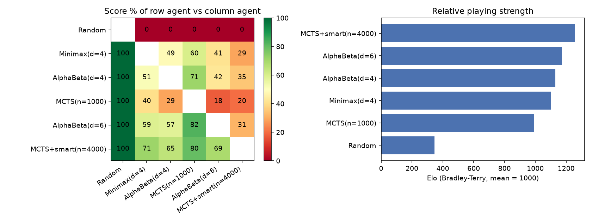
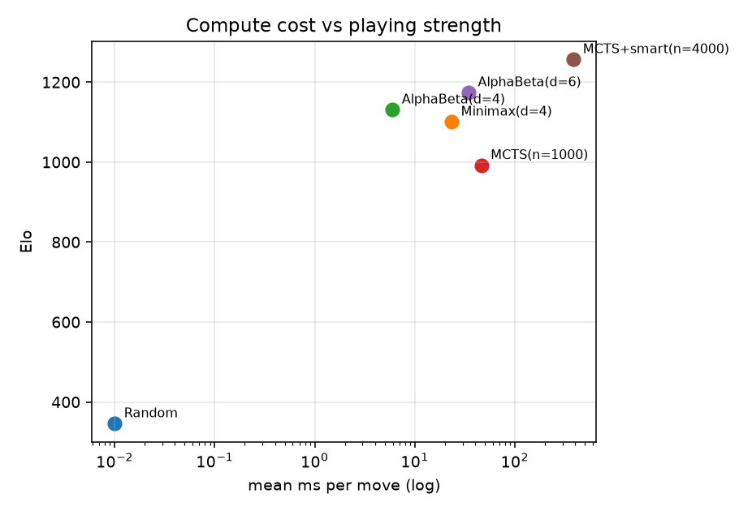
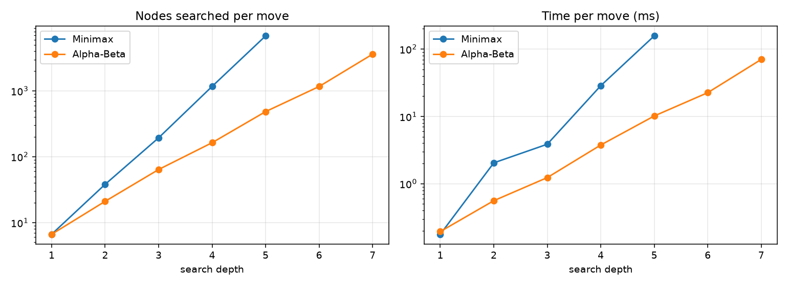
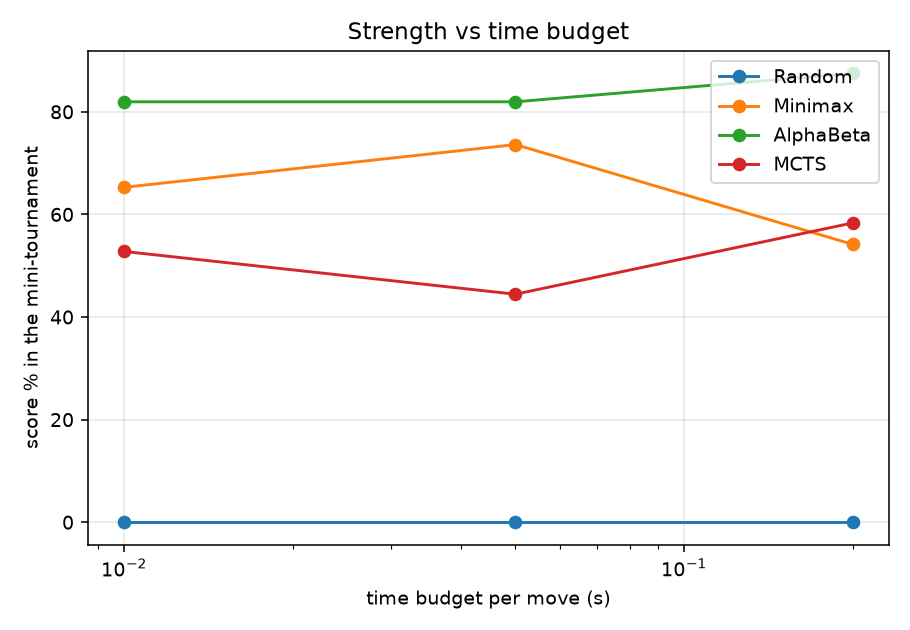
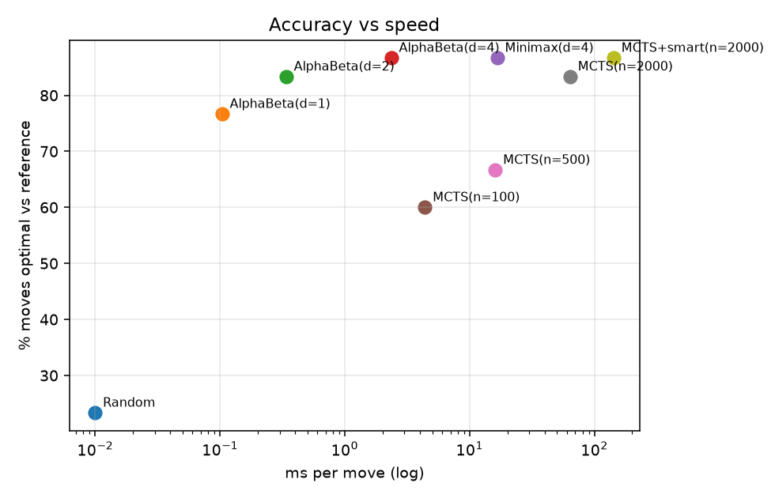

# StratNet4 - Results Report

## 1. Round-robin tournament

| Agent | Score % | W | D | L | Elo | ms/move | nodes/move | avg depth |
|---|---|---|---|---|---|---|---|---|
| MCTS+smart(n=4000) | 77.0 | 147 | 14 | 39 | 1257 | 383.9 | 4000 | - |
| AlphaBeta(d=6) | 66.0 | 119 | 26 | 55 | 1174 | 34.3 | 1846 | 6.0 |
| AlphaBeta(d=4) | 60.0 | 110 | 20 | 70 | 1131 | 6.0 | 228 | 4.0 |
| Minimax(d=4) | 55.8 | 103 | 17 | 80 | 1101 | 23.2 | 1187 | 4.0 |
| MCTS(n=1000) | 41.2 | 80 | 5 | 115 | 992 | 46.0 | 1000 | - |
| Random | 0.0 | 0 | 0 | 200 | 346 | 0.0 | 0 | - |

## 2. Pruning efficiency (Minimax vs Alpha-Beta, same depth)

Averaged over 30 random mid-game positions.

| Depth | Minimax nodes | AB nodes | Node reduction % | Minimax ms | AB ms | Speed-up x | Same value % |
|---|---|---|---|---|---|---|---|
| 1 | 7 | 7 | 0.0 | 0.18 | 0.19 | 0.9 | 100 |
| 2 | 38 | 21 | 44.8 | 2.04 | 0.56 | 3.6 | 100 |
| 3 | 194 | 64 | 67.0 | 3.86 | 1.23 | 3.1 | 100 |
| 4 | 1171 | 163 | 86.1 | 28.58 | 3.76 | 7.6 | 100 |
| 5 | 6853 | 484 | 92.9 | 156.94 | 10.15 | 15.5 | 100 |
| 6 | - | 1166 | - | - | 22.50 | - | - |
| 7 | - | 3615 | - | - | 70.14 | - | - |

## 3. Strength under equal time budgets (per move)

| Budget | Agent | Score % | Elo | Avg depth reached | Nodes or rollouts/move |
|---|---|---|---|---|---|
| 0.01s | Random | 0.0 | 569 | - | 0 |
| 0.01s | Minimax(t=0.01s) | 65.3 | 1134 | 3.6 | 876 |
| 0.01s | AlphaBeta(t=0.01s) | 81.9 | 1244 | 4.4 | 886 |
| 0.01s | MCTS(t=0.01s) | 52.8 | 1053 | - | 446 |
| 0.05s | Random | 0.0 | 554 | - | 0 |
| 0.05s | Minimax(t=0.05s) | 73.6 | 1196 | 4.6 | 2924 |
| 0.05s | AlphaBeta(t=0.05s) | 81.9 | 1255 | 5.9 | 3137 |
| 0.05s | MCTS(t=0.05s) | 44.4 | 994 | - | 2591 |
| 0.2s | Random | 0.0 | 562 | - | 0 |
| 0.2s | Minimax(t=0.2s) | 54.2 | 1060 | 4.9 | 10055 |
| 0.2s | AlphaBeta(t=0.2s) | 87.5 | 1290 | 6.7 | 11632 |
| 0.2s | MCTS(t=0.2s) | 58.3 | 1087 | - | 13195 |

## 4. Move accuracy

Reference = Alpha-Beta depth 6 (exact value of every move) on 30 positions; tactical tests: 30 win-in-1 and 30 must-block positions.

| Agent | Ref-optimal % | Blunder % | Win-in-1 % | Block-in-1 % | ms/move |
|---|---|---|---|---|---|
| Random | 23.3 | 33.3 | 6.7 | 10.0 | 0.00 |
| AlphaBeta(d=1) | 76.7 | 0.0 | 100.0 | 96.7 | 0.10 |
| AlphaBeta(d=2) | 83.3 | 0.0 | 100.0 | 96.7 | 0.34 |
| AlphaBeta(d=4) | 86.7 | 0.0 | 100.0 | 96.7 | 2.35 |
| Minimax(d=4) | 86.7 | 0.0 | 100.0 | 96.7 | 16.59 |
| MCTS(n=100) | 60.0 | 3.3 | 96.7 | 80.0 | 4.38 |
| MCTS(n=500) | 66.7 | 0.0 | 100.0 | 90.0 | 16.05 |
| MCTS(n=2000) | 83.3 | 0.0 | 100.0 | 96.7 | 63.74 |
| MCTS+smart(n=2000) | 86.7 | 0.0 | 100.0 | 96.7 | 142.17 |

